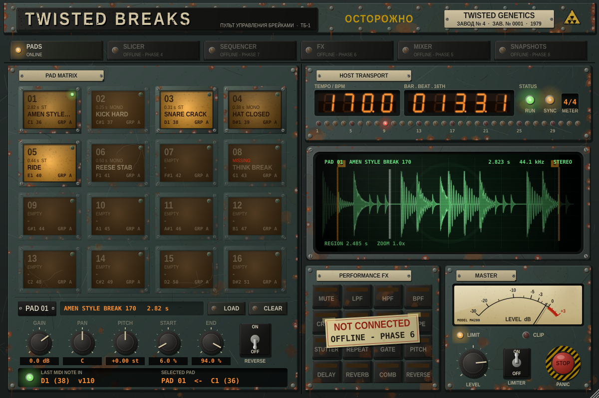

# TWISTED BREAKS

A jungle / drum & bass performance sampler, break slicer, sequencer and
multi-FX instrument for Ableton Live — built in C++ with JUCE 8 as a real
**VST3** and **Audio Unit** plugin.

Skinned as a forty-year-old Soviet power-plant control console (Russian
in the header, English labels everywhere else): oxidised
enamel, rust, bakelite label plates, amber annunciator pads, a green-phosphor
CRT and a red emergency-stop panic button.



## Install (no building needed)

Every green build publishes a release. Open **Releases** on the right of the
repo page, download **TwistedBreaks-macOS.zip** from the newest one, and
follow the `INSTALL.txt` inside: copy the `.vst3` and `.component` into your
plug-in folders, clear macOS quarantine, rescan in Ableton.

## Status

| Phase | What | State |
|---|---|---|
| 1 | Plugin shell, MIDI, host transport, master section, skin | **done** |
| 2 | Sample playback: load, waveform editor, pitch, gain, pan, start/end, reverse | **done** — 90/90 automated checks |
| 3 | Per-pad modes (one-shot / loop / host-sync), choke groups, mute / solo | next |
| 4–8 | Slicing, groups, FX, sequencer, snapshots | planned — see [docs/ARCHITECTURE.md](docs/ARCHITECTURE.md) |

Sections that aren't built yet are visibly marked offline on the panel
(dark lamps and taped-on tags).

### What works now
* **Load samples** (WAV / AIFF, also FLAC) onto any of the 16 pads: drag a
  file onto a pad, onto the screen, or press **LOAD**. Decoding happens in the
  background, so loading never glitches audio. **CLEAR** empties a pad.
* Pads show the sample name, length and channels; a missing file shows
  **MISSING** in red and keeps its path.
* **Waveform editor** on the CRT for the selected pad: drag the **S** / **E**
  markers to set start and end, wheel or pinch to zoom, drag to scroll,
  double-click to zoom out, with a live playback cursor. Non-destructive.
* Per-pad **GAIN, PAN, PITCH** (+/-12 semitones), **START, END, REVERSE**. All
  96 are Ableton-automatable (`pad01_gain` ... `pad16_reverse`).
* Sample-exact playback with Hermite interpolation, velocity sensitivity,
  automatic sample-rate conversion (a 44.1 kHz break plays correctly in a
  48 kHz set), click-free starts, ends, retriggers and panic.
* Triggered by mouse (click higher = harder) or MIDI notes **36–51**
  (C1–D#2, an Ableton Drum Rack layout), sample-accurately.
* Host **BPM, bar.beat.16th, time signature, play state** and a **32-step
  playhead** from Ableton.
* Master **level**, zero-latency **limiter**, needle **peak meter**, **PANIC**
  (red STOP button, automatable `Panic` parameter, or MIDI CC 120).
* Saved in the Live Set: all parameters, sample paths and the MIDI note map.
* Resizable window (75 %-150 %).

## Build it yourself (optional)

One-time setup:

```bash
xcode-select --install          # Apple command-line tools (clang, git)
brew install cmake              # or install CMake from cmake.org
```

Build (JUCE 8.0.4 is downloaded automatically on first configure):

```bash
git clone https://github.com/TwistedGenetics/twisted-breaks.git
cd twisted-breaks
cmake -B build -S . -DCMAKE_BUILD_TYPE=Release -DTB_COPY_AFTER_BUILD=ON
cmake --build build --config Release -j 8
```

`-DTB_COPY_AFTER_BUILD=ON` installs the plugins straight into your user
plug-in folders. Builds are universal (Apple Silicon + Intel).

Run the automated tests:

```bash
./build/TwistedBreaksTests_artefacts/Release/TwistedBreaksTests
```

Prefer Xcode? `cmake -B build-xcode -S . -G Xcode` and open
`build-xcode/TwistedBreaks.xcodeproj`.

Use a local JUCE checkout instead of downloading:
`cmake -B build -S . -DTB_JUCE_PATH=/path/to/JUCE`

### Where the binaries appear

| Format | Build output | Installed to (with `TB_COPY_AFTER_BUILD`) |
|---|---|---|
| VST3 | `build/TwistedBreaks_artefacts/Release/VST3/TwistedBreaks.vst3` | `~/Library/Audio/Plug-Ins/VST3/` |
| AU | `build/TwistedBreaks_artefacts/Release/AU/TwistedBreaks.component` | `~/Library/Audio/Plug-Ins/Components/` |

### Automatic builds (GitHub Actions)

Every push builds universal VST3 + AU on a macOS runner, runs the test suite,
validates the AU with `auval` and the VST3 with `pluginval`, and uploads
**TwistedBreaks-macOS.zip** as a workflow artifact (Actions tab → latest run →
Artifacts).

### Signing notes

* Plugins you build yourself run as-is — the linker ad-hoc signs them.
* Plugins **downloaded** from the Actions artifact are quarantined by macOS.
  After copying them into the plug-in folders, clear it:
  ```bash
  xattr -dr com.apple.quarantine ~/Library/Audio/Plug-Ins/VST3/TwistedBreaks.vst3
  xattr -dr com.apple.quarantine ~/Library/Audio/Plug-Ins/Components/TwistedBreaks.component
  ```
* Distributing to other people later needs an Apple Developer ID certificate
  plus notarisation (`codesign --options runtime` + `xcrun notarytool`).

## Load it in Ableton Live

1. Settings → Plug-Ins → turn on **Use Audio Units v2** and **Use VST3 Plug-in
   System Folders** → **Rescan**.
2. Browser → Plug-Ins → *Twisted Genetics* → **TwistedBreaks** (it's an
   instrument). Drop it on a MIDI track.
3. If the AU doesn't appear after rebuilding: `killall -9 AudioComponentRegistrar`
   and rescan.

Full test plan: [docs/ABLETON_TEST_CHECKLIST.md](docs/ABLETON_TEST_CHECKLIST.md).

## Project layout

See [docs/ARCHITECTURE.md](docs/ARCHITECTURE.md) for the architecture,
threading model, host-sync strategy, voice design, slicing, FX, state format,
Ableton pitfalls and the phase roadmap.

```
Source/Core     parameters, transport sync, lock-free UI⇄audio bridge
Source/Engine   all real-time DSP
Source/UI       the control-room skin and components
Tests           headless test runner (+ editor snapshot renderer)
```
