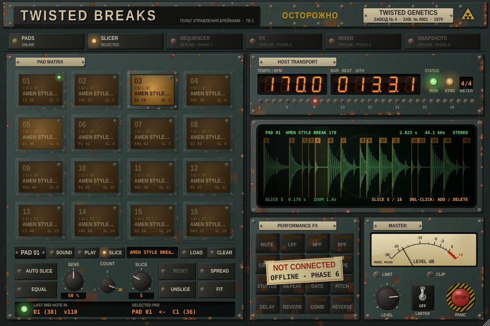

# TWISTED BREAKS

A jungle / drum & bass performance sampler, break slicer, sequencer and
multi-FX instrument for Ableton Live — built in C++ with JUCE 8 as a real
**VST3** and **Audio Unit** plugin.

Skinned as a forty-year-old Soviet power-plant control console (Russian
in the header, English labels everywhere else): oxidised
enamel, rust, bakelite label plates, amber annunciator pads, a green-phosphor
CRT and a red emergency-stop panic button.



## Install (no building needed)

Every green build publishes a release. Open **Releases** on the right of the
repo page, download **TwistedBreaks-macOS.zip** from the newest one, and
follow the `INSTALL.txt` inside: copy the `.vst3` and `.component` into your
plug-in folders, clear macOS quarantine, rescan in Ableton.

## Status

| Phase | What | State |
|---|---|---|
| 1 | Plugin shell, MIDI, host transport, master section, skin | **done** |
| 2 | Sample playback: load, waveform editor, pitch, gain, pan, start/end, reverse | **done** |
| 3 | Pad modes (one-shot / loop), tempo-synced loops, choke groups, mute / solo, velocity, MIDI learn | **done** |
| 4 | Transient detection, slice markers, SLICE mode, SPREAD to pads | **done** |
| 4.1 | SWAP groups: hand off between breaks at slice points | **done** — 175/175 automated checks |
| 5 | Four group buses + mixer | **done** |
| 5.1 | iRig Pads lights: controller pads show what's playing | **done** |
| 5.2 | FIXED velocity key per pad | **done** — 216/216 automated checks |
| 6 | 16 performance FX per group | **done** — 267/267 automated checks |
| 7 | 32-step sequencer + live recording | **done** — 296/296 automated checks |
| 7.1 | Per-pad slice sequencer | **done** — 333/333 automated checks |
| 8 | Snapshots, break bank, find missing samples | **done** — 362/362 automated checks |
| 9+ | Later ideas | planned — see [docs/ARCHITECTURE.md](docs/ARCHITECTURE.md) and [docs/SPEC_ADDITIONS.md](docs/SPEC_ADDITIONS.md) |

Sections that aren't built yet are visibly marked offline on the panel
(dark lamps and taped-on tags).

### What works now
* **Load samples** (WAV / AIFF, also FLAC) onto any of the 16 pads: drag a
  file onto a pad, onto the screen, or press **LOAD**. Decoding happens in the
  background, so loading never glitches audio. **CLEAR** empties a pad.
* Pads show the sample name, length and channels; a missing file shows
  **MISSING** in red and keeps its path.
* **Waveform editor** on the CRT for the selected pad: drag the **S** / **E**
  markers to set start and end, wheel or pinch to zoom, drag to scroll,
  double-click to zoom out, with a live playback cursor. Non-destructive.
* **SOUND page** per pad: **GAIN, PAN, PITCH** (+/-12 semitones), **START,
  END, REVERSE**.
* 567 Ableton-automatable parameters with stable IDs (`pad01_gain` ...
  `pad16_fixvel`, `grp_a_level` ... `grp_d_bypass`, `grp_a_lpf` ...
  `grp_d_reverse_size`).
* Sample-exact playback with Hermite interpolation, velocity sensitivity,
  automatic sample-rate conversion (a 44.1 kHz break plays correctly in a
  48 kHz set), click-free starts, ends, retriggers and panic.
* **PLAY page** per pad (the SOUND / PLAY keys switch pages):
  * **MODE**: ONE (plays once) or LOOP (repeats while the pad / note is
    held, with a crossfaded loop point), or SLICE (see below).
  * **SYNC**: loops lock to Ableton's tempo and bar grid. The loop length
    in beats is worked out from the audio (a 4-beat break stays 4 beats),
    triggering mid-bar enters at the right point, and it re-locks after
    loop-brace jumps and tempo changes.
  * **RATE**: 1/4, 1/2, 1x, 2x loop speed.
  * **CHOKE** 1-4: a hit stops the other pads in the same group (3 ms fade).
  * **VEL**: velocity sensitivity, 0% (always full) to 100%.
  * **FIX**: fixed velocity, every hit at full level (automatable
    `pad01_fixvel`).
  * **M / S**: mute and solo.
  * **NOTE**: drag or scroll to change the pad's MIDI note, or LEARN and
    play a note on your controller.
* **SLICE page** (or the SLICER key in the top rail):
  * **AUTO SLICE** finds the hits in a break (kicks, snares, hats) and puts
    a numbered marker on each, just before the attack. **SENS** sets how
    quiet a hit it picks up; **COUNT** (4 / 8 / 16) keeps the strongest.
  * **EQUAL** cuts COUNT equal slices instead.
  * On the screen: drag markers, double-click to add, double-click a marker
    to delete, click a slice to select it (and hear it in SLICE mode).
    **RESET** undoes your edits, **UNSLICE** removes them, **FIT** zooms out.
  * **SLICE mode** (PLAY page, MODE) plays the slice chosen by the **SLICE**
    knob (automatable: `pad01_slice`).
  * **SPREAD** puts each slice on its own pad from the selected pad onwards,
    in SLICE mode, sharing one copy of the audio — drag a break in, AUTO
    SLICE, SPREAD, and play it from your controller.
* **SWAP page**: put pads holding sliced breaks in the same **SWAP group**
  (1-4). One plays at a time, latched. Hit another and it takes over at the
  playing break's **next slice marker** (or next 1/16, beat or bar: **AT**),
  carrying on from the same point in its own break and starting right on
  its own hit. The waiting pad flashes. Hit the playing pad again to stop.
* **Group buses A-D**: every pad goes to a group (**GROUP** keys on the
  SOUND page; tiles show "GRP B"). The **MIXER** key swaps the screen for
  four channel strips: **fader**, LED meter, **PAN**, **M**ute, **S**olo and
  FX **BYPASS** (FX arrive in Phase 6). Click a strip's name plate to send
  the selected pad there. All automatable (`grp_a_level` ... `grp_d_bypass`).
* **LIGHTS** (bottom-left, next to SELECTED PAD): pick your **iRig Pads** and
  its pads light up: green while a pad plays (brightness follows the sound),
  dim green for loaded pads, flashing red while a SWAP is queued. Works out
  of the box on the iRig's default scene; **Learn pad layout** handles any
  other scene (hit each pad as it lights red). **Test lights** and **Swap
  red / green** in the same menu. Saved with the set.
* **Performance FX** (bottom middle): pick a group (GRP A-D), then the 16
  keys switch that group's effects: MUTE, LPF, HPF, BPF, CRUSH, RATE,
  DRIVE, TAPE, STUTTER, REPEAT, GATE, PITCH (drop), DELAY, REVERB, COMB,
  REVERSE, in that order in the chain. Each key is LOCKED (click on / off)
  or MOMENTARY (held), marked L / M. STUTTER, REPEAT and REVERSE land on the
  next 1/16, 1/8 ... of Live's grid; DELAY and REVERB are throws whose tails
  ring on. The **FX** key opens the FX editor for the picked key (right-
  click a key to edit without switching it): its settings, LOCKED /
  MOMENTARY, ALL OFF. MIDI notes **C3-D#4** play FX 1-16 of the selected
  group; everything is automatable. PANIC stops tails and switches FX off.
* **SEQUENCER** (top rail): a 32-step lane for every pad. Click a cell for a
  step, drag up / down on it for velocity, click it again to clear it.
  **LEN** 1-32, **STEP** 1/8 / 1/16 / 1/32, **RUN**: all automatable. It
  follows Live's transport exactly (sample-accurate, restarts and loop-brace
  jumps land on the right step). **ARM** a pad (click its lane number to
  select it) and hits from the mouse or MIDI are recorded while Live plays,
  quantised to **REC Q** (1/4, 1/8, 1/16, 1/32; finer than the step size
  is kept as micro-timing). Patterns are saved with the set.
* **Slice sequencer** (pad editor **SEQ** tab): rearrange a sliced break.
  Switch **SLICE SEQ** on and the pad plays its own pattern of slices when
  hit (hit again to stop). Untouched, the pattern replays the break exactly
  as recorded, at any tempo. On the screen: 32 steps, each a slice, a
  REST or a TIE (let it ring); drag a step up / down to pick its slice and
  set REV, PITCH, VEL, gate LEN, RATCHET, CHANCE and MICRO for the selected
  step. SHUFFLE (beats stay put), RANDOM, REVERSE, HALF, ROTATE, RESET, hold
  FILL for rolls, STEP REC to write slices by tapping SPREAD pads. 8 SLOTs
  per pad (automatable, switch at the pattern start), LEN, RATE (1/8 ...
  1/16T), SWING. Works with SWAP groups (hand-off on the next step), choke,
  groups and FX.
* **SNAPSHOTS** (top rail): 8 slots. **STORE** then click a slot to capture
  every pad (sample, slices, all settings), the mixer, every effect and
  both sequencers; click a slot to recall it **NOW**, on the **NEXT BEAT** or
  **NEXT BAR**, exactly on the boundary sample. Also MIDI Program Change
  1-8 and the automatable `Snapshot` parameter (write snapshot changes into
  your arrangement). The master section stays as it is.
* **Break bank** (same view): 8 breaks. Pads with **FOLLOW BANK** (SWAP page,
  or ALL SLICE PADS FOLLOW) play the active break; switch it (click, or
  automate `Break Bank`) and every following pad - and every slice
  sequence - changes break on the next beat / bar.
* **FIND MISSING**: point it at a folder and every missing sample is found
  (sub-folders too) and reloaded with its slices.
* Triggered by mouse (click higher = harder) or MIDI notes **36–51**
  (C1–D#2, an Ableton Drum Rack layout), sample-accurately.
* Host **BPM, bar.beat.16th, time signature, play state** and a **32-step
  playhead** from Ableton.
* Master **level**, zero-latency **limiter**, needle **peak meter**, **PANIC**
  (red STOP button, automatable `Panic` parameter, or MIDI CC 120).
* Saved in the Live Set: all parameters, sample paths, slice markers (and
  the RESET point), slicer settings and the MIDI note map;
  changes made in the plugin window are reported to Live, so save,
  duplicate-track and undo all pick them up (AU and VST3).
* Resizable window (75 %-150 %).

## Build it yourself (optional)

One-time setup:

```bash
xcode-select --install          # Apple command-line tools (clang, git)
brew install cmake              # or install CMake from cmake.org
```

Build (JUCE 8.0.4 is downloaded automatically on first configure):

```bash
git clone https://github.com/TwistedGenetics/twisted-breaks.git
cd twisted-breaks
cmake -B build -S . -DCMAKE_BUILD_TYPE=Release -DTB_COPY_AFTER_BUILD=ON
cmake --build build --config Release -j 8
```

`-DTB_COPY_AFTER_BUILD=ON` installs the plugins straight into your user
plug-in folders. Builds are universal (Apple Silicon + Intel).

Run the automated tests:

```bash
./build/TwistedBreaksTests_artefacts/Release/TwistedBreaksTests
```

Prefer Xcode? `cmake -B build-xcode -S . -G Xcode` and open
`build-xcode/TwistedBreaks.xcodeproj`.

Use a local JUCE checkout instead of downloading:
`cmake -B build -S . -DTB_JUCE_PATH=/path/to/JUCE`

### Where the binaries appear

| Format | Build output | Installed to (with `TB_COPY_AFTER_BUILD`) |
|---|---|---|
| VST3 | `build/TwistedBreaks_artefacts/Release/VST3/TwistedBreaks.vst3` | `~/Library/Audio/Plug-Ins/VST3/` |
| AU | `build/TwistedBreaks_artefacts/Release/AU/TwistedBreaks.component` | `~/Library/Audio/Plug-Ins/Components/` |

### Automatic builds (GitHub Actions)

Every push builds universal VST3 + AU on a macOS runner, runs the test suite,
validates the AU with `auval` and the VST3 with `pluginval`, and uploads
**TwistedBreaks-macOS.zip** as a workflow artifact (Actions tab → latest run →
Artifacts).

### Signing notes

* Plugins you build yourself run as-is — the linker ad-hoc signs them.
* Plugins **downloaded** from the Actions artifact are quarantined by macOS.
  After copying them into the plug-in folders, clear it:
  ```bash
  xattr -dr com.apple.quarantine ~/Library/Audio/Plug-Ins/VST3/TwistedBreaks.vst3
  xattr -dr com.apple.quarantine ~/Library/Audio/Plug-Ins/Components/TwistedBreaks.component
  ```
* Distributing to other people later needs an Apple Developer ID certificate
  plus notarisation (`codesign --options runtime` + `xcrun notarytool`).

## Load it in Ableton Live

1. Settings → Plug-Ins → turn on **Use Audio Units v2** and **Use VST3 Plug-in
   System Folders** → **Rescan**.
2. Browser → Plug-Ins → *Twisted Genetics* → **TwistedBreaks** (it's an
   instrument). Drop it on a MIDI track.
3. If the AU doesn't appear after rebuilding: `killall -9 AudioComponentRegistrar`
   and rescan.

Full test plan: [docs/ABLETON_TEST_CHECKLIST.md](docs/ABLETON_TEST_CHECKLIST.md).

## Project layout

See [docs/ARCHITECTURE.md](docs/ARCHITECTURE.md) for the architecture,
threading model, host-sync strategy, voice design, slicing, FX, state format,
Ableton pitfalls and the phase roadmap.

```
Source/Core     parameters, transport sync, lock-free UI⇄audio bridge
Source/Engine   all real-time DSP
Source/UI       the control-room skin and components
Tests           headless test runner (+ editor snapshot renderer)
```
